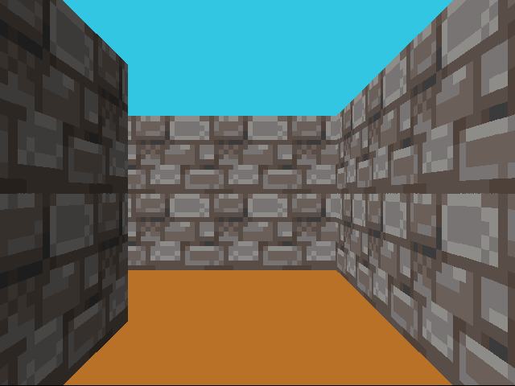
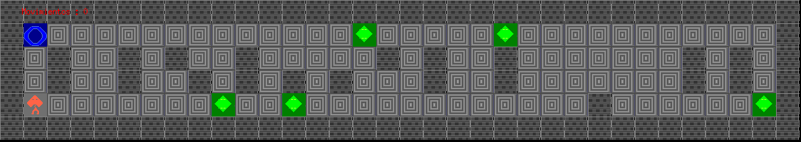

# 42 Madrid, common core

Every project of the common core at 42 Madrid, Fundación Telefónica, September 2023 to November 2025, alongside the telecommunications engineering degree in Valladolid. No teachers, no classes: a project, a subject PDF, a deadline, and other students grading you.

C, Unix, networking, C++, Docker. The order below is the order of the curriculum.

| project | what it is | mark |
| --- | --- | --- |
| [Libft](Libft) | a C standard library rewrite: strings, memory, lists, number conversion | 125 |
| [ft_printf](printf) | `printf` with `%c %s %p %d %i %u %x %X %%`, variadic, buffered | 100 |
| [get_next_line](get_next_line) | read a line at a time from any fd with a static buffer; bonus handles many fds at once | 112 |
| Born2beroot | a hardened Debian VM: partitions, sudo policy, SSH, firewall, monitoring script (no code to show) | 100 |
| [push_swap](push_swap) | sort a stack with two stacks and eleven moves, in as few moves as possible | 84 |
| [pipex](pipex) | `< file cmd1 \| cmd2 > file` reproduced with `fork`, `pipe`, `dup2` and `execve` | 100 |
| [so_long](so_long) | a 2D tile game on MiniLibX: map parsing and validation, sprites, movement, collectibles, exit | 110 |
| [Philosophers](philosophers) | dining philosophers with threads and mutexes, no deadlocks, no data races, deaths detected on time | 100 |
| [minishell](minishell) | a shell: quotes, expansions, builtins, pipes, redirections, heredocs, signals | 101 |
| [cub3d](cub3d) | a Wolfenstein-style raycaster: `.cub` scene parsing, textured walls, movement, minimap | 115 |
| NetPractice | TCP/IP addressing and routing exercises (no code to show) | 100 |
| [CPP modules 00–09](CPP) | C++98 from classes to templates, STL containers and algorithms | 80 · 100 · 80 · 80 · 80 · 100 · 100 · 100 · 100 · 100 |
| [ft_irc](ft_irc) | an IRC server in C++98 on `poll()`: registration, channels, modes, operators, private messages | 100 |
| [Inception](inception) | NGINX, WordPress and MariaDB as separate containers on Docker Compose, TLS, persistent volumes | 100 |
| [ft_transcendence](https://github.com/jaimeol/ft_transcendence) | the final project, in a team of four: Pong with accounts, friends, chat and tournaments, Fastify and TypeScript | 125 |

Five exam ranks, all passed at 100. Before all this, the piscine: [piscine](piscine), four weeks of C and shell in August 2023.

  

  

## Notes

- Everything compiles with `-Wall -Wextra -Werror` and was checked with valgrind or the sanitizers, because the grading requires it. Each project has its own `Makefile`; `make` in the folder builds it.
- The graphics projects (`so_long`, `cub3d`) use MiniLibX for Linux and need X11 headers: `libx11-dev libxext-dev zlib1g-dev`.
- Team projects: `minishell` with Javier Morales ([@JaviMoraales](https://github.com/JaviMoraales)); `ft_irc` and `ft_transcendence` with [@jaimeol](https://github.com/jaimeol), [@JaviMoraales](https://github.com/JaviMoraales) and [@rpisoner](https://github.com/rpisoner). The rest are individual.
- The whole graph, project by project, is on [alonsosandoval.com/42](https://alonsosandoval.com/42).
